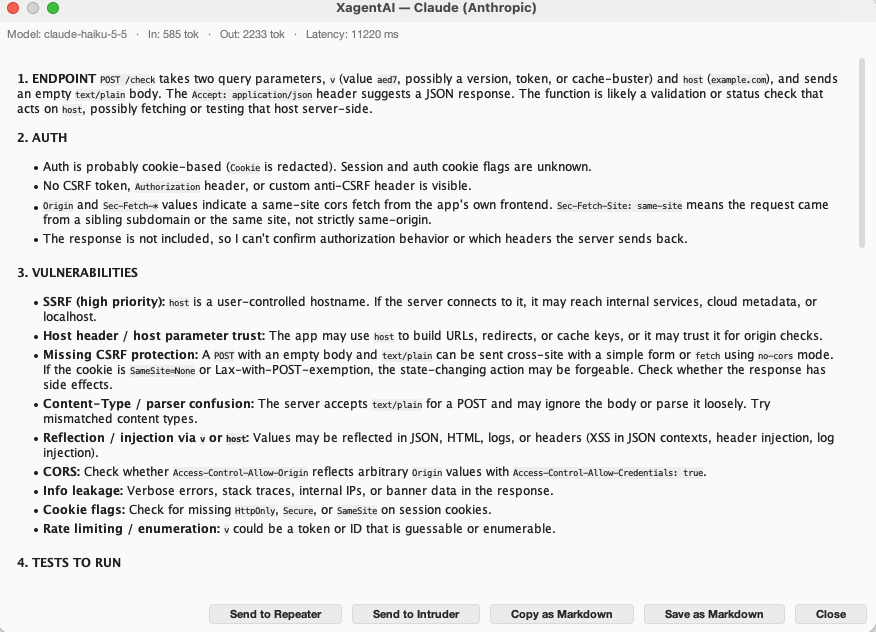
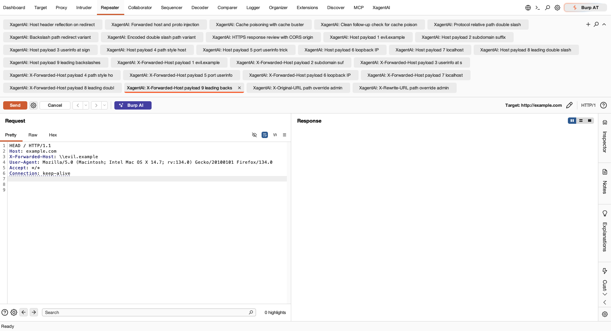
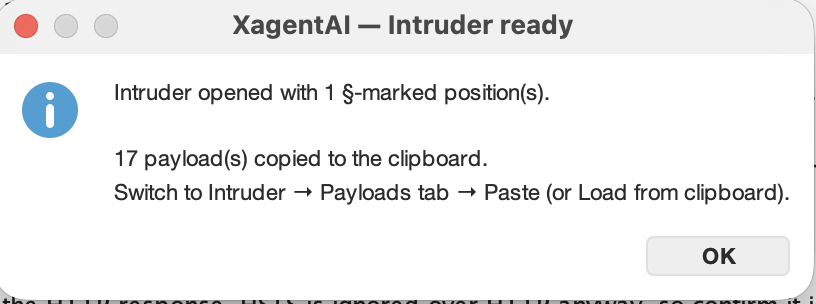
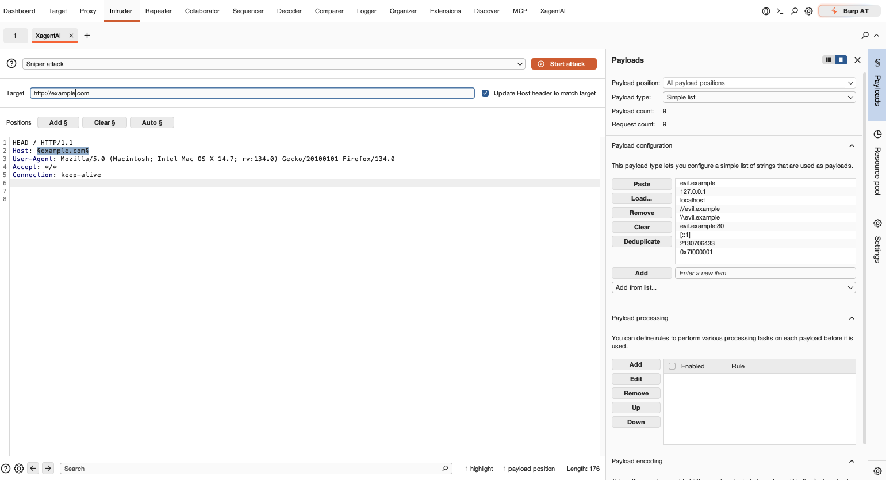

# Artificial Intelligence for Burp Suite — XagentAI

> Bring multiple AI providers directly into the Burp Suite workflow:
> right-click any request → get a structured security analysis → send
> AI-proposed tests to Repeater or Intruder with a single click.

[](https://github.com/marcodemm/artificial-intelligence-for-burp-suite-xagentai-net/releases/latest)
[](LICENSE)

📦 **[Download the latest JAR](https://github.com/marcodemm/artificial-intelligence-for-burp-suite-xagentai-net/releases/latest/download/xagentai-burp-ai-0.2.0.jar)** — drop it into Burp via **Extensions → Installed → Add → Java**.
See [Install](#install) for the step-by-step.

- **Name in Burp:** `Artificial Intelligence for Burp Suite - XagentAI`
- **Version:** `0.2.0`
- **Author:** [xagentai.net](https://xagentai.net)
- **License:** [Apache-2.0](LICENSE)
- **Burp API:** Montoya API (`2026.7`)
- **Runtime:** Java 17+

---

## Table of contents

1. [What it does](#what-it-does)
2. [Screenshots](#screenshots)
3. [Supported AI providers](#supported-ai-providers)
4. [Where it integrates in Burp](#where-it-integrates-in-burp)
5. [Install](#install)
6. [Configure](#configure)
7. [Use](#use)
8. [Privacy &amp; PII sanitization](#privacy--pii-sanitization)
9. [Build from source](#build-from-source)
10. [License](#license)

---

## What it does

`XagentAI` is a Java extension for Burp Suite Professional / Community built
on PortSwigger's [Montoya API](https://portswigger.github.io/burp-extensions-montoya-api/javadoc/).
It gives the operator three right-click entry points on every
request-bearing panel of Burp:
- **Analyze with AI** — structured security analysis of the selected
  request / response.
- **WAF Bypass with AI** — fingerprints the WAF in the response and asks
  the AI to generate concrete bypass-variant requests, each one ready to
  fire in its own Repeater tab.
- **Active WAF Detection** — opt-in active probe based on
  [identYwaf](https://github.com/stamparm/identYwaf) (MIT): sends 45
  crafted payloads at 2 req/s and identifies the WAF among ~95
  vendors by its blocking pattern. Chains straight into *WAF Bypass
  with AI* with the detected WAF as a seed hint.

### Positioning

**This is not a conversational AI agent you chat with.** It is a bridge
between Burp's own native workflows (Proxy History, Repeater, Intruder,
Scanner, Target Site Map, WebSocket History) and external AI providers —
one right-click sends the request you already have in front of you to the
AI, and the AI's proposed tests land back where they belong in Burp
(Repeater tabs, Intruder with `§...§` positions). The operator stays in
control of every action; there is no autonomous mode, no agent loop and
no tool-calling layer in front of Burp.

The result dialog renders the AI's answer (Markdown → HTML) and exposes four
action buttons:

- **Send to Repeater** — asks the AI a second time to convert the `TESTS TO
  RUN` section of its previous answer into real HTTP requests, parses them,
  and opens each one in its **own Repeater tab** named `XagentAI: <test
  name>`. The same pipeline is reused by the **WAF Bypass with AI** action,
  which produces blocks named `XagentAI: WAF <WAF>: <technique>`.
- **Send to Intruder** — asks the AI to pick the best `§...§` insertion
  points on the original request, opens **Intruder with the positions already
  set**, and copies the suggested payload list to the clipboard (paste into
  Payloads → Simple list).
- **Copy as Markdown** — raw analysis to the clipboard, ready to drop into a
  report.
- **Save as Markdown** — same content as *Copy as Markdown* but dumped to a
  `.md` file on disk via a file chooser (default
  `~/Desktop/xagentai-<provider>-<yyyyMMdd-HHmmss>.md`, UTF-8, overwrite
  confirmation). Useful for keeping each analysis as evidence in the
  engagement folder without round-tripping through the clipboard.

There is **no automatic mode**, **no telemetry** and **no outbound traffic**
beyond the AI endpoint the operator configured.

---

## Screenshots

### Right-click menu (Proxy, Repeater, Intruder, Scanner, Target, WebSockets)


### Analysis dialog (Markdown-rendered)



### Settings — About tab


### Send to Repeater — one tab per AI-proposed test



### Send to Intruder — §-marked positions &amp; payloads on the clipboard





---

## Supported AI providers

| Provider      | Kind  | Default endpoint                                      | Default model                     |
|---------------|-------|-------------------------------------------------------|-----------------------------------|
| **Claude**    | Cloud | `https://api.anthropic.com`                           | `claude-haiku-5-5`                |
| **OpenAI**    | Cloud | `https://api.openai.com`                              | `gpt-4o-mini`                     |
| **Gemini**    | Cloud | `https://generativelanguage.googleapis.com`           | `gemini-2.5-flash`                |
| **NVIDIA**    | Cloud | `https://integrate.api.nvidia.com`                    | `nvidia/nemotron-3.5-super-vl-120b-a12b` |
| **LM Studio** | Local | `http://localhost:1234/v1`                            | auto-detect via `/v1/models`      |
| **Ollama**    | Local | `http://localhost:11434`                              | auto-detect via `/v1/models`      |
| **llama.cpp** | Local | `http://localhost:8080` (`llama-server`)              | whatever `llama-server` loaded    |

Notes on provider quirks:

- **Claude 5 family** (`claude-opus-5-*`, `claude-sonnet-5-*`,
  `claude-haiku-5-*`, `claude-fable-5-*`) — the `temperature` parameter is
  deprecated by Anthropic and automatically omitted by the plugin. For older
  Claude models the operator's configured temperature is sent as-is.
- **OpenAI reasoning models** (`o1*`, `o3*`, `o4*`, `gpt-5*`) — the
  `temperature` parameter is likewise omitted, as those models do not accept
  it.
- **LM Studio Model combo** is left empty by default: the plugin fetches
  `/v1/models` and uses whichever model is currently loaded in LM Studio. The
  **Refresh** button repopulates the combo and marks the loaded model in bold.
- **Ollama** is addressed through its OpenAI-compatible endpoint
  (`/v1/chat/completions`), not the native `/api/chat` one.
- **Google Gemini** is addressed through Google's OpenAI-compatibility
  layer at `/v1beta/openai/chat/completions` (currently in beta;
  feature-compatible subset of the native Gemini API — enough for
  `messages[]` + `max_tokens` + `temperature`). API key comes from Google
  AI Studio.

Each sub-tab in **Settings** has a **Test connection** button that round-trips
a short request and reports latency + outcome.

---

## Where it integrates in Burp

The right-click entries **Extensions → Artificial Intelligence for Burp
Suite - XagentAI → Analyze with AI / WAF Bypass with AI / Active WAF
Detection** appear in:

| Burp panel           | What is sent to the AI                                       |
|----------------------|--------------------------------------------------------------|
| **Proxy History**    | Selected request + response                                  |
| **Repeater**         | Current request + last response                              |
| **Intruder** (editor)| Current request template                                     |
| **Scanner Issues**   | Issue (name, severity, confidence) + request/response pair   |
| **Target Site Map**  | Selected nodes' request/response pairs                       |
| **WebSocket History**| Selected frames (direction, payload, timestamp)              |

*WAF Bypass with AI* only fires on a **single** row that has a response
attached (needs the WAF's reply to fingerprint it); on multi-selection or
response-less rows it refuses with a pop-up.

The plugin also registers a top-bar **XagentAI** tab that hosts the Settings
panel (10 sub-tabs: Active provider · Claude · OpenAI · Gemini · NVIDIA ·
LM Studio · Ollama · llama.cpp · Behaviour · About).

### Note on WebSocket analysis

The right-click entry on **WebSocket History** sends the selected frames
(plus the upgrade request as context) to the AI. The tests the AI then
proposes are almost always attacks against the **HTTP upgrade handshake**
itself — CSWSH / `Origin` bypass, reconnect with an old session, auth
bypass on signed URLs, and so on — because that is where most of the
WebSocket attack surface lives.

Montoya API `2026.7` does not expose a way for an extension to open
Repeater in WebSocket mode (`burp.api.montoya.repeater.Repeater` only
accepts `HttpRequest`), so **Send to Repeater** opens each handshake test
in a regular HTTP Repeater tab — which is exactly where these checks
belong, since they are HTTP requests.

For manual frame replay against an already-authenticated session, use
Burp's own native **Send to Repeater** on a WebSocket History entry
(that opens the dedicated WebSocket Repeater panel with the
`To client` / `To server` dropdown and the `Reconnect` button). The two
flows are complementary: use the plugin for handshake-level attacks, and
Burp's native WebSocket Repeater for frame-level replay.

---

## Install

### From a downloaded `.jar`

1. Download the latest JAR from
   **[GitHub Releases](https://github.com/marcodemm/artificial-intelligence-for-burp-suite-xagentai-net/releases/latest)**
   (direct link:
   [xagentai-burp-ai-0.2.0.jar](https://github.com/marcodemm/artificial-intelligence-for-burp-suite-xagentai-net/releases/latest/download/xagentai-burp-ai-0.2.0.jar)),
   or build it yourself — see [Build from source](#build-from-source).
2. In Burp: **Extensions → Installed → Add** → Extension type: `Java` →
   select the `.jar`.
3. Open the **XagentAI** top-bar tab → **Settings** → configure your active
   provider (API key / endpoint / model).
4. Click **Save settings** (bottom-right of the Settings panel).
   > **Important.** Every change in Settings — API key, **Model from the
   > combo**, temperature, timeout, Sanitize mode, active provider — is only
   > persisted when you click **Save settings**. Changing the Model combo
   > and forgetting to Save is the most common foot-gun: the next analysis
   > will silently keep using the previously saved model. The green
   > `Settings saved.` label at the bottom-right confirms it took effect.
5. Click **Test connection** on your active provider's sub-tab to verify.

### From the BApp Store

*Planned for a future release once the extension has been reviewed and
accepted by PortSwigger.*

---

## Configure

Every provider has the same simple form (API key, Base URL, Model, Max
tokens, Temperature, Timeout). All fields have sensible defaults; the only
ones you typically need to set are:

- An **API key** for the cloud providers you plan to use.
- A **Base URL** / **Model** for the local providers you plan to use
  (defaults already assume the vendor's stock localhost port).

Pick the backend that handles the right-click action in the **Active
provider** tab.

### Behaviour tab

One setting: **Sanitize PII (headers)** — a combo with three modes:

| Mode       | What it does                                                                 |
|------------|------------------------------------------------------------------------------|
| `ACTIVE`   | Always redact sensitive header values before sending to the AI (local too). |
| `INACTIVE` | Never redact — the request is sent as-is to the AI.                         |
| `AUTO` *(default)* | Redact only when the active provider is **cloud-hosted**. Local providers always receive the request as-is since nothing leaves the machine. |

Headers covered when sanitization runs (values replaced with `[REDACTED]`;
header names are kept so the model still sees that auth was present):

```
Authorization, Proxy-Authorization, Cookie, Set-Cookie,
X-Api-Key, X-Auth-Token, X-Amz-Security-Token, X-CSRF-Token
```

See [Privacy &amp; PII sanitization](#privacy--pii-sanitization) for the
rationale.

---

## Use

The canonical flow is:

1. **Right-click** a request in Proxy History (or any supported panel) →
   **Extensions → Artificial Intelligence for Burp Suite - XagentAI →
   Analyze with AI**.
2. A progress dialog shows the elapsed seconds while the active provider
   generates the analysis.
3. The **result dialog** opens with the Markdown-rendered analysis and
   four buttons:
   - **Send to Repeater** — the AI generates concrete HTTP requests from
     its `TESTS TO RUN` section; each one opens in its own Repeater tab.
     Click **Send** in each tab to fire it, inspect the response, iterate.
   - **Send to Intruder** — the AI marks the best `§...§` insertion
     point(s) on the original request and opens Intruder with them. Switch
     to the **Payloads** tab → **Paste** (the payload list is on the
     clipboard) → **Start attack**.
   - **Copy as Markdown** — paste the raw AI output straight into your
     bug-bounty / pentest report.
   - **Save as Markdown** — same content, saved as a `.md` file on disk
     (default filename `xagentai-<provider>-<yyyyMMdd-HHmmss>.md` under
     `~/Desktop`), so you can keep each analysis as evidence in the
     engagement folder.

The result dialog is **modeless**, so you can keep it open while you work
in Repeater / Intruder and come back to it for the next action.

### WAF Bypass with AI

For requests that come back with a blocking status code (typically 403,
406, 419, 429 or 503), the second right-click entry **WAF Bypass with
AI** takes a dedicated path:

1. The plugin **fingerprints the WAF / CDN** from the response headers,
   cookies and body (Cloudflare, Akamai, AWS CloudFront/WAF, Imperva
   Incapsula, Sucuri, F5 BIG-IP/ASM, ModSecurity, Fortinet FortiWeb,
   Barracuda, Fastly, Google Cloud Armor, Azure Front Door, Wordfence).
   If none of those 13 strong signatures matches, it falls back to the
   bundled identYwaf catalog of ~95 WAFs (passive regex match over the
   raw response); last resort is a status-code hint.
2. It asks the active provider for a Markdown analysis that lists the
   confirmed WAF, why the block likely triggered, the bypass strategy
   tailored to that WAF (modern 2026 techniques — path confusion,
   TE/CL smuggling, method switching, content-type confusion,
   URL-encoding mutations, HPP, trusted-IP spoofing headers specific to
   the detected CDN), and out-of-band notes (JA3/JA4 evasion, origin-IP
   discovery, DNS history) that must be run outside Burp.
3. The AI also emits **5 to 15 concrete request variants**, each one
   wrapped in the same `=== TEST: ===` block contract that the regular
   analysis uses, so **Send to Repeater** opens each variant in its own
   tab named `XagentAI: WAF <WAF>: <technique>`.
4. Click **Send** on each tab and sort by status code to spot the
   variant that got through (`200` / `302` instead of `403` / `429`).

> ⚠️ **Ethical note.** WAF-bypass testing is a legitimate technique on
> targets where it is in scope, but many bug-bounty programs (HackerOne,
> BugCrowd, Intigriti) list WAF bypass as *intended behavior, out of
> scope*. Read the program policy before firing this action against a
> third-party target.

### Active WAF Detection

An opt-in active probe based on
[identYwaf](https://github.com/stamparm/identYwaf) (MIT, Copyright
2019-2026 Miroslav Stampar — see
[`NOTICE-identywaf.txt`](NOTICE-identywaf.txt)). Use it when the response
alone isn't enough to identify the WAF (silent WAFs that strip their own
headers, generic error pages, unknown vendors).

1. Right-click the request → **Active WAF Detection**.
2. A confirmation pop-up shows the exact number of requests the probe
   will send (1 baseline + 45 crafted payloads = **46 requests**), the
   target URL, and the rate limit. Nothing goes out until you confirm.
3. The plugin sends 45 identYwaf payloads (SQLi, XSS, XXE, LDAPi, path
   traversal, …) at **2 requests per second**, each one under a random
   query parameter. Classification = "blocked" when the response status
   differs from the baseline or when the body contains any of
   identYwaf's protection keywords.
4. The resulting bit-vector is matched against identYwaf's catalog of
   **~95 WAFs**: exact match first, then partial-match with
   confidence percentage per WAF.
5. Result dialog shows: blind-match table with confidence per WAF,
   passive regex hits picked up on the way, per-payload table, and a
   **"Run WAF Bypass with AI"** button that chains into the previous
   action with the top-detected WAF as a seed hint.

> ⚠️ **Same ethical note applies, with teeth.** Active WAF Detection is
> *active intrusive probing*. Only run it against targets where the
> program policy explicitly permits WAF testing. On many programs this
> counts as abusing a security control and is out of scope.

---

## Privacy &amp; PII sanitization

When the operator picks "Analyze with AI" on a target request, the plugin
serializes the full request (and sometimes the response) and sends it to the
AI endpoint. For **cloud** providers (Claude / OpenAI / Gemini / NVIDIA)
this means those bytes leave your machine over the network and may:

- Be logged by the provider for abuse / debugging purposes.
- Depending on your contract, be used for model training (Anthropic
  Messages API: no training on API data; OpenAI: depends on your
  org-level opt-out; Google Gemini: depends on the tier you use in
  Google AI Studio / Vertex AI — read Google's current Terms before
  enabling it on sensitive traffic; NVIDIA NIM: depends on the
  deployment). Check your provider's current policy before enabling a
  cloud backend on a sensitive target.
- Contain material that should not leave the engagement:
  `Authorization: Bearer <real JWT>`, `Cookie: session=<real>`,
  `X-Api-Key: <real>`, PII in the request body, …

The **Sanitize PII** combo redacts the **values** of the header list above
before serialization. The header **names** are kept so the AI still sees
that an `Authorization` / `Cookie` was present, which is enough context for
most analyses.

For engagements with sensitive data, prefer a **local** provider (LM Studio,
Ollama or llama.cpp) — nothing leaves your machine, and `AUTO` sanitization
correctly turns into a no-op.

### No telemetry

The plugin itself makes **zero** outbound requests to `xagentai.net` or any
other third party. The only outbound traffic is to the AI endpoint the
operator configured.

---

## Build from source

Requirements:

- JDK 17 or newer (`java -version`).
- Gradle 8+ (the project ships a wrapper; `./gradlew` works without a
  system Gradle once it has been bootstrapped once).

```bash
./gradlew clean build
```

The fat JAR appears in `build/libs/xagentai-burp-ai-X.Y.Z.jar` (ready to
load into Burp as-is; all runtime dependencies are shaded inside).

### Developer-only: auto-install into Burp after each build

Create a **gitignored** `gradle.properties.local` next to `build.gradle.kts`:

```properties
burp.plugins.dir=/absolute/path/to/your/burp-plugins
```

The `installToBurp` task (wired as a `build` finalizer) then copies the JAR
to that folder on every successful build.

### Tests

```bash
./gradlew test
```

### Package for distribution

```bash
./gradlew packageForBurp
```

Writes `dist/xagentai-burp-ai-X.Y.Z.jar` with a clean, versioned name.

---

## License

Licensed under the [Apache License, Version 2.0](LICENSE).

Copyright © 2026 [xagentai.net](https://xagentai.net).

Burp Suite® is a registered trademark of PortSwigger Ltd. This project is
an independent extension and is not affiliated with or endorsed by
PortSwigger.
